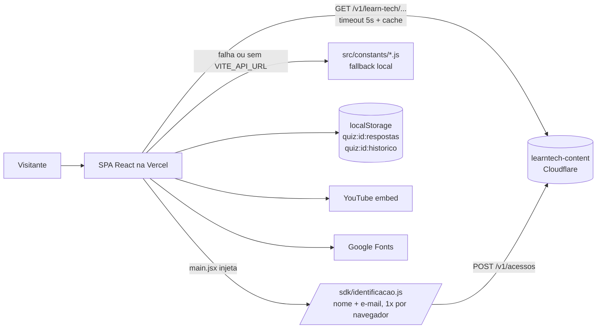
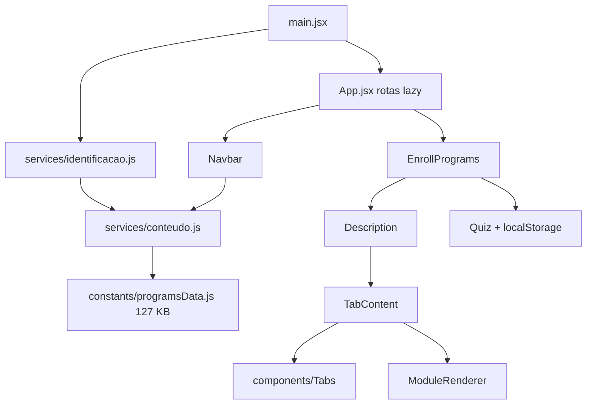
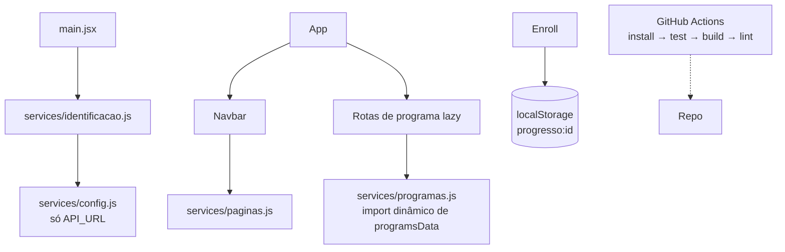

# learn-tech — Arquitetura e plano

> 27/10/2026 · branch `feature/claudeia-2026-10-27`. Itens marcados **inferido · confirmar** dependem do dono.

## 1. Arquitetura atual

Observação: como `identificacao.js` e `Navbar.jsx` importam `conteudo.js`, que importa `programsData.js`, o catálogo inteiro vai no chunk principal.

## 2. Arquitetura alvo (sem mudar produto)

## 3. Decisões (ADR curto)

| ID | Decisão | Contexto | Consequência | Situação |
| --- | --- | --- | --- | --- |
| ADR-01 | CI roda só `npm test`, `npm run build` e `npm run lint` (este informativo) | Scripts já existem no `package.json`; lint nunca foi verificado nesta revisão | CI não bloqueia por lint até o dono confirmar | Aceita (executada) |
| ADR-02 | CI usa `npm install`, não `npm ci` | `package-lock.json` está no `.gitignore` | Builds não reprodutíveis até L2-01 | Aceita (provisória) |
| ADR-03 | `Tabs` suporta modo controlado e não controlado | `TabContent` já passava `activeIndex`/`onChange`; comentários em `EnrollPrograms.jsx` declaram a intenção | Lista lateral e "avançar módulo" passam a trocar a aba; aparência inalterada | Aceita (executada) |
| ADR-04 | Identificação de acesso é regra de negócio | Mede volume de acesso do ecossistema (README do `learntech-content`) | Nenhuma proposta remove ou contorna o SDK; só aperfeiçoamentos (redação, fallback) | Aceita — **inferido · confirmar** |
| ADR-05 | Fallback local de conteúdo permanece | Site precisa funcionar se a API cair | Duplicação de dados entre repositórios continua; contrato de dados protege o local | Aceita |
| ADR-06 | Progresso no navegador (OFF-only) | Decisão de set/2026 no README | Persistência de módulo deve usar `localStorage`, nunca conta | Proposta (L3-03) |

## 4. Plano em lotes

Legenda de esforço: P (< 1 h), M (1–4 h), G (> 4 h) — **estimativa**.

### Lote 1 — engenharia segura (executado nesta revisão)

| ID | Item | Motivo | Arquivos | Critério de pronto | Esforço | Risco | Muda o produto? | Situação |
| --- | --- | --- | --- | --- | --- | --- | --- | --- |
| L1-01 | Workflow de CI | Não havia verificação automática | `.github/workflows/ci.yml` | Workflow verde em push/PR | P | Baixo | Não | Feito |
| L1-02 | `Tabs` respeita `activeIndex`/`onChange` | Clique na lista lateral e "avançar" não trocavam a aba | `src/components/tabs/Tabs.jsx` | Clicar "Módulo 3" na lateral mostra a aba 3; concluir módulo abre o próximo | P | Baixo | Não (restaura comportamento pretendido) | Feito |
| L1-03 | Validação do formato lido do `localStorage` no Quiz | Dado antigo/inválido podia quebrar `[...quizHistory]` | `src/pages/enroll/quiz/Quiz.jsx` | Com `quiz:1:historico` = `"x"` a página abre normalmente | P | Baixo | Não | Feito |
| L1-04 | Visualizer não abre navegador com `CI=true` | Evitar falha/espera em CI | `vite.config.js` | Build local continua abrindo o relatório; no CI não | P | Baixo | Não | Feito |
| L1-05 | Documentação de revisão e roteiros de teste | Registro e verificação | `docs/claudeia/*` | Arquivos presentes | P | Nenhum | Não | Feito |
| — | `lang`/meta description | Já estavam corretos (`index.html:2,11-14`) | — | — | — | — | — | Nada a fazer |

### Lote 2 — engenharia, depende de execução local

| ID | Item | Motivo | Arquivos | Critério de pronto | Esforço | Risco | Muda o produto? | Situação |
| --- | --- | --- | --- | --- | --- | --- | --- | --- |
| L2-01 | Versionar `package-lock.json` e trocar CI para `npm ci` | Reprodutibilidade | `.gitignore`, `ci.yml` | Lock no Git; CI com `npm ci` verde | P | Baixo | Não | Proposta |
| L2-02 | Zerar lint: remover `import React` sem uso (35 arquivos) ou adicionar `varsIgnorePattern: '^[A-Z_]'`; `react.version: 'detect'` | Lint provavelmente falha | `eslint.config.js`, `src/**` | `npm run lint` sem erro; tirar `continue-on-error` | P–M | Baixo | Não | Proposta |
| L2-03 | Unificar mapa de ícones do `ModuleRenderer` com `constants/icones.js` e usar no teste | Duplicação em 3 lugares | `ModuleRenderer.jsx`, `icones.js`, `dados.test.js` | Teste usa o mesmo mapa do renderizador | M | Médio | Não | Proposta |
| L2-04 | Carregar a fonte por `<link rel="preconnect">` + `<link>` no `index.html` em vez de `@import` | Render-blocking | `index.html`, `index.css` | Mesma fonte; Lighthouse sem aviso de cadeia crítica | P | Baixo | Não | Proposta |
| L2-05 | Remover código e assets órfãos | ~1,5 MB e 5 arquivos sem uso | ver relatório 2.3/2.5 | `npm run build` igual; nenhum import quebrado | P | Baixo | Não | Proposta (exige apagar — aprovar) |
| L2-06 | Atualizar README (vídeo, branches, `services/`, contagem de rotas, persistência real) | Documentação divergente | `Readme.md`, `conteudo.js:83` | README bate com o código | P | Nenhum | Não | Proposta |
| L2-07 | `aria-label` nos botões do menu móvel ("Abrir menu"/"Fechar menu") | Acessibilidade | `Navbar.jsx:65,91` | Leitor de tela anuncia o botão | P | Nenhum | Não visual | Proposta |
| L2-08 | Não publicar `dist/stats.html` (gerar só com variável, ex.: `ANALYZE=1`) | Artefato interno no deploy | `vite.config.js` | `dist/` sem `stats.html` no build padrão | P | Baixo | Não | Proposta |
| L2-09 | Cabeçalhos de segurança (CSP permitindo API, YouTube, Google Fonts) | Endurecimento | `vercel.json` | Site funciona com CSP ativa | M | Médio | Não | Proposta |

### Lote 3 — decisões de produto (só com aprovação)

| ID | Item | Motivo | Arquivos | Critério de pronto | Esforço | Risco | Muda o produto? | Situação |
| --- | --- | --- | --- | --- | --- | --- | --- | --- |
| L3-01 | Tirar o catálogo do chunk principal (import dinâmico) | 465 KB no primeiro carregamento | `conteudo.js`, `identificacao.js`, `Navbar.jsx` | Chunk principal < 200 KB sem gzip | M | Médio | Não visível | Proposta |
| L3-02 | Estado "em breve" para os 30 programas sem conteúdo | Carregamento infinito (P1) | `Description.jsx`, `Detail.jsx` | Programa sem conteúdo mostra aviso claro | P–M | Baixo | **Sim** | Aprovar |
| L3-03 | Persistir progresso de módulo e checklist no `localStorage` | Promessa em `Detail.jsx:306` e README | `EnrollPrograms.jsx`, `ModuleRenderer.jsx` | Recarregar mantém % e passos | M | Baixo | **Sim** | Aprovar |
| L3-04 | Ligar o "Fala aê" a um destino real | Mensagens perdidas; canal LGPD | `FalaAe.jsx` (+ API) | Mensagem chega ao dono; erro de envio visível | M–G | Médio | **Sim** | Aprovar |
| L3-05 | Ajustar redação "sem cadastro" mantendo a identificação | Coerência com o SDK | `index.html`, `Hero.jsx`, `Detail.jsx` | Texto aprovado pelo dono | P | Baixo | **Sim (texto)** | Aprovar |
| L3-06 | Corrigir `/blogs` (página de lista ou outro destino) | Link quebrado | `Blog.jsx`, `App.jsx` | Link não cai no 404 | P–M | Baixo | **Sim** | Aprovar |
| L3-07 | Cor da aba ativa (`in-500` → `indigo-500`) e `grid-colds-1` | Classes inválidas | `Tabs.jsx`, `Blog.jsx` | Aba ativa destacada | P | Baixo | **Sim (visual)** | Aprovar |
| L3-08 | Open Graph com textos existentes | Compartilhamento | `index.html` | Prévia correta em rede social | P | Nenhum | Sim (metadado) | Aprovar |
| L3-09 | Unificar categorias Home × catálogo | Incoerência | `categoriesData.js` | Mesmas categorias nos dois lugares | P | Baixo | **Sim** | Aprovar |
| L3-10 | Hierarquia de títulos (um `h1` por página) | Acessibilidade | `Quiz.jsx`, `EnrollPrograms.jsx`, `QuickAccess.jsx` | Um `h1` por página, mesma aparência | P | Baixo | Não visual | Proposta |
